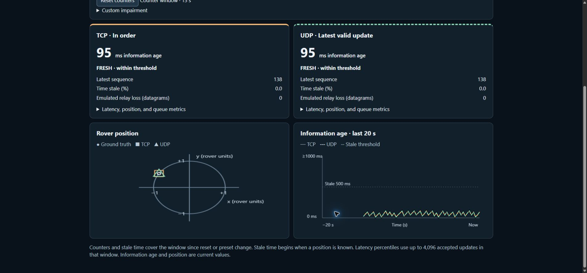

# FreshLink

FreshLink is an offline telemetry freshness lab for exploring TCP, UDP, and stale information. See [the project scope](docs/PROJECT.md) and [the wire protocol](docs/PROTOCOL.md).

The transport demo requires Python 3.11 or later. From the repository root, start the receiver in one PowerShell or Linux terminal, then start the sender in another:

```text
python -m src.freshlink receive tcp --timeout 30 --debug
python -m src.freshlink send tcp --debug
```

Use `udp` in both commands to try datagrams. The TCP receiver exits at EOF and the UDP receiver exits after idle timeout or Ctrl+C. For a shorter UDP demo, start the receiver with `--timeout 5` and send within five seconds.

Both commands default to IPv4 loopback `127.0.0.1`, port `8765`, and a three-second socket timeout. The sender defaults to 20 samples at 10 samples per second and accepts a maximum rate of 100 per second. Change these with `--host`, `--port`, `--timeout`, `--count`, and `--rate`. The receiver can bind port zero and prints the selected port.

Run the tests with `python -m unittest discover -s tests -v`.

To start the live dashboard and open your default browser, run this from the repository root in PowerShell:

```powershell
python -m src.freshlink.server --open
```

The server listens on `http://127.0.0.1:8000/`. Use `--port 0` to pick an available port or open the printed URL manually if needed. Press Ctrl+C in PowerShell to stop the demo.

The dashboard's presets apply emulated conditions and reset the counter window. **Reset counters** also starts a new window while retaining the latest received position. The age plot covers the last 20 seconds and caps its vertical axis at 1,000 ms. Follow [the demo script](docs/DEMO.md) for a guided walkthrough.



Run the headless experiment suite with Python 3.11 or later:

```powershell
python -m experiments.run
python -m experiments.analyze results/raw/runs.csv --output results/raw/analysis
```

The first command runs 70 trials. Use `--quick` with both commands for a short smoke run or `--output` to select a new CSV path for the runner. The analyzer writes summary statistics and two SVG figures. All experiment code uses the standard library. See [the experiment report](docs/REPORT.md) for the conditions and results.

### Run through the impairment relay

From the repository root, run each line in its own terminal, in order. The relay listens on `127.0.0.1:8766` and forwards to the receiver on `127.0.0.1:8765`.

```text
python -m src.freshlink receive tcp --timeout 30 --debug
python -m tools.impair_proxy tcp --timeout 30 --seed 17 --delay-ms 120 --jitter-ms 30 --bytes-per-second 400 --debug
python -m src.freshlink send tcp --port 8766 --debug
```

For UDP, use the following commands:

```text
python -m src.freshlink receive udp --timeout 30 --debug
python -m tools.impair_proxy udp --timeout 30 --seed 17 --delay-ms 40 --jitter-ms 10 --loss 0.2 --duplicate 0.2 --reorder 0.3 --reorder-ms 200 --corrupt 0.1 --debug
python -m src.freshlink send udp --port 8766 --debug
```

The relay runs in user space with no administrator permissions. TCP delay, jitter, queueing, and bandwidth limits are **emulated at the application layer**. The relay preserves the bytes it forwards and does not create native TCP segment loss or exercise kernel retransmission. UDP fault options change which datagrams the relay forwards and when.

Use `python -m tools.impair_proxy --help` for all options. Fault options are probabilities from 0 to 1. The default seed is 0, the queue has 64 slots, and a zero byte rate leaves the relay unpaced. Addresses default to IPv4 loopback and the sender still defaults to 10 samples per second. TCP serves one connection and drains on EOF or idle. UDP drains after input goes idle. Ctrl+C stops either process. See the [relay walkthrough](docs/EXPLAIN-impairment.md).
