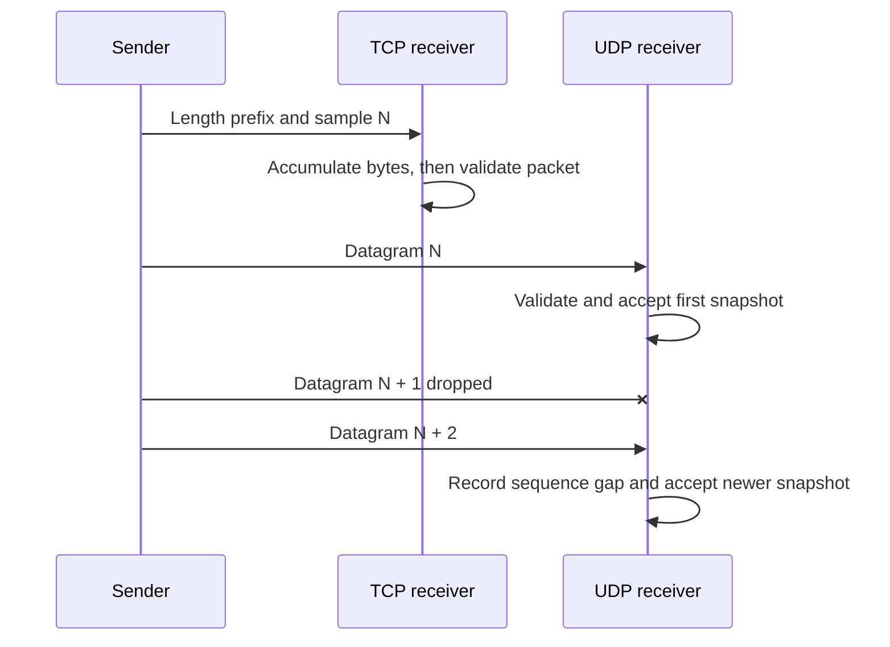

# FreshLink wire protocol, version 1

Each sample is a complete rover state. TCP uses the same packet as UDP, preceded by an unsigned four-byte length. That prefix counts packet bytes only. On UDP, one packet occupies one datagram.

| Wire order | Field | Encoding |
| --- | --- | --- |
| 1 | Version | Unsigned 8-bit integer, value 1 |
| 2 | Message type | Unsigned 8-bit integer, value 1 for telemetry |
| 3 | Sequence | Unsigned 32-bit integer, advances modulo 2³² |
| 4 | Reserved ACK | Unsigned 32-bit integer, value 0 in version 1 |
| 5 | Body length | Unsigned 16-bit integer, counts the timestamp, coordinates, and label |
| 6 | CRC-32 | Unsigned 32-bit integer, computed over fields 1–5 followed by the body |
| 7 | Generation time | Unsigned 64-bit nanoseconds from the same host's monotonic counter |
| 8 | Position | Two finite IEEE 754 binary64 values, x then y |
| 9 | Label | Remaining body bytes, strict UTF-8, optionally empty |

All numeric fields use network byte order. The packet is 40–1,200 bytes, so the label can occupy up to 1,160 bytes. CRC-32 detects corruption in the lab. It provides no authentication. The reserved ACK field carries no delivery signal.

TCP reads exactly four prefix bytes, validates the announced size, then reads exactly that many bytes under one deadline. EOF before any prefix byte ends the stream. Partial EOF, an invalid packet, or a timeout ends the connection. A failed send can leave a partial frame and also ends the connection. These rules apply because [TCP delivers an ordered byte stream](https://www.rfc-editor.org/rfc/rfc9293.html).

UDP accepts the first valid snapshot and remembers its sender address for the run. For later snapshots from that sender, the forward modular distance must lie in `[1, 2³¹)` and the generation timestamp must be at least as recent as the newest accepted timestamp. Equality of sequence values is a duplicate. Values at or past half range are ambiguous or stale. The comparison follows [RFC 1982](https://www.rfc-editor.org/rfc/rfc1982.html#section-3.2) and assumes one sender per run with less than half the serial space between comparable samples. Restart the receiver when starting a new UDP sender run.

A forward jump exposes skipped sequence numbers. Reordering can also produce such a jump, so the receiver cannot infer permanent loss from the jump alone. Every valid snapshot is independently usable. The sender has no timeout driven retry or application acknowledgment for the [UDP path](https://www.rfc-editor.org/rfc/rfc768.html).

Generation timestamps use `perf_counter_ns()` on the same host. They are suitable for comparing elapsed time within this lab. Absolute dates and synchronized clocks across hosts are outside this format's scope.
