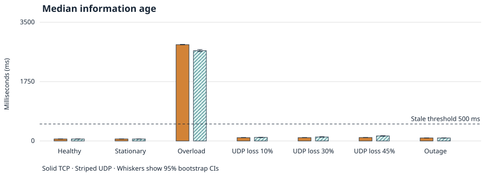
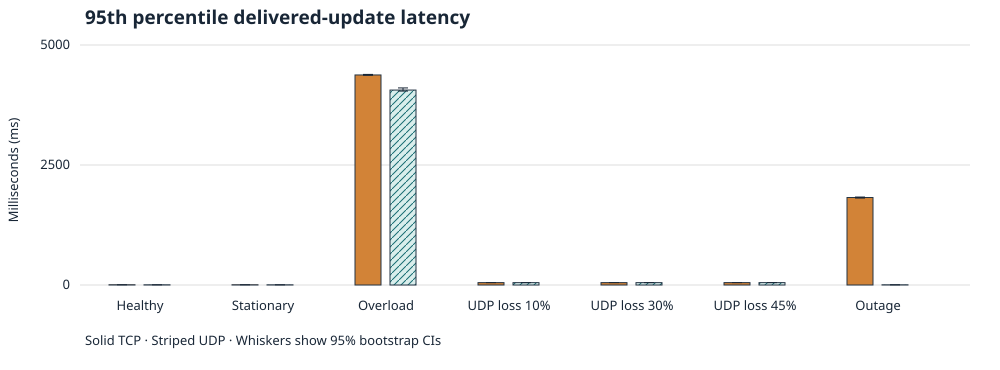

# FreshLink loopback experiment report

## Design

A single monotonic-clock source produces the same sequence, generation timestamp, and position for both paths. Each path has a bounded sender queue and real loopback sockets. TCP preserves frame order through the user-space relay. UDP can accept a newer snapshot after a gap. Both receivers use the same latest-position model and compare it with source ground truth.

## Method

Run from the repository root:

```text
python -m experiments.run
python -m experiments.analyze results/raw/runs.csv --output results/raw/analysis
```

Each repeat includes all seven conditions, with shuffled order from seed 1729. Relay seeds are 1730 through 1739 and paired across conditions within a repeat. Every trial uses fresh sockets and counters, a 1.5 s warm-up, and a 6 s observation window. Condition settings are active during warm-up, except the outage trial, which begins healthy. TCP and UDP run simultaneously. The CSV records each trial's actual observed duration, seed, repeat, order, settings, UTC timestamp, Python version and OS.

Healthy uses the unmodified relay. The stationary control repeats Healthy with a fixed rover position. Queue overload uses the dashboard preset of 70 ms delay, 25 ms jitter, and 180 application B/s. The UDP-loss conditions use 10%, 30%, or the dashboard preset of 45% configured loss with 30 ms shared delay. The outage trial pauses TCP release and drops newly admitted UDP datagrams from the scheduled 1.2 s boundary until the 3.3 s boundary. The recovery timer starts at the healthy-control acknowledgment. Recovery is the first polling observation of a post-acknowledgment sample with age at or below 500 ms. Missing recoveries are censored and retained in the raw rows.

Age and position error use snapshots scheduled every 50 ms. Age is computed from generation time, and position error is Euclidean distance in rover units. Stale fraction integrates time above 500 ms after the first known sample in the current or preceding window. Delivered-update latency percentiles use nearest rank on samples accepted during the window, including any queued before it. Useful update rate divides accepted updates by observed seconds. Source queue drops and delays are distinct from relay loss draws and overflow.

The summary CSV reports each condition and path's median, quartiles, sample variance, and a 95% percentile bootstrap interval for the median across runs, using 4,000 resamples and a fixed analysis seed. Recovery entries disclose missing observations. Paired healthy parity checks use median absolute TCP/UDP gaps. The loss check divides injected UDP losses by packets received at the relay and compares with a tolerance of three binomial standard errors or three percentage points, whichever is larger. Harness checks use process CPU time, achieved source rate, maximum observed polling gap, and a timer sleep probe at the polling interval.

## Results

The [run CSV](../results/experiment-runs.csv) contains all 70 paired trials, with 140 protocol rows. No reference trial was excluded. The [summary CSV](../results/summary.csv) contains the complete results, counts, quartiles, variance, and confidence intervals. The reference run used Python 3.14.6 on Windows 11 (build 26300).

### Validity checks

All declared checks passed on this host. Healthy median absolute paired gaps were 0.000 ms for run median age, 0.894 ms for run p95 latency, and 0.000 updates/s for useful update rate. The limits were 10 ms, 10 ms, and 0.5 updates/s respectively. The nonzero latency gap is consistent with the paths using different socket and relay handling. The trial did not isolate those costs from scheduling variation.

| Configured UDP loss | Relay drops / received | Observed | Tolerance (percentage points) |
| ---: | ---: | ---: | ---: |
| 10% | 66 / 548 | 12.04% | 3.84 |
| 30% | 153 / 548 | 27.92% | 5.87 |
| 45% | 255 / 550 | 46.36% | 6.36 |

Maximum process CPU use was 8.33% of one core against a 50% limit. The minimum achieved source rate was 9.00 Hz against the 8.00 Hz floor. The largest sampling gap was 86.59 ms against a 100 ms limit. The 50 ms sleep probe returned a median of 50.034 ms and a maximum of 57.429 ms, despite a reported monotonic clock resolution of 0.100 µs. The achieved source rate and observed gaps show why the nominal frequency and clock resolution are insufficient descriptions of Windows timing.

### Observed behavior

Each cell gives TCP / UDP medians across ten runs. The latency columns summarize the corresponding within-run percentile.

| Condition | Median age (ms) | Delivered latency median (ms) | Delivered latency p95 (ms) | Delivered latency p99 (ms) | Time stale (%) |
| --- | ---: | ---: | ---: | ---: | ---: |
| Healthy | 59.096 / 58.182 | 4.539 / 3.684 | 5.128 / 4.250 | 5.500 / 4.516 | 0.0 / 0.0 |
| Stationary | 59.402 / 58.113 | 4.223 / 3.439 | 4.855 / 3.993 | 5.558 / 4.561 | 0.0 / 0.0 |
| Queue overload | 2840.269 / 2661.864 | 2819.013 / 2578.235 | 4375.850 / 4061.187 | 4549.300 / 4212.124 | 100.0 / 100.0 |
| 10% UDP loss | 98.591 / 105.337 | 48.507 / 48.150 | 49.592 / 49.163 | 50.290 / 49.887 | 0.0 / 0.0 |
| 30% UDP loss | 99.255 / 116.772 | 48.214 / 48.082 | 49.517 / 49.208 | 49.928 / 49.507 | 0.0 / 0.0 |
| 45% UDP loss | 102.082 / 148.165 | 48.374 / 48.343 | 49.763 / 49.397 | 50.069 / 49.484 | 0.0 / 1.6 |
| Outage | 88.841 / 88.034 | 4.708 / 3.712 | 1822.676 / 4.214 | 2040.966 / 4.432 | 27.6 / 28.3 |

- **Queue overload impaired both paths.** Median useful rates fell to 3.499 TCP and 3.833 UDP updates/s, versus 9.165 on both healthy paths. Median position errors reached 1.789 and 1.827 rover units. The 95% bootstrap intervals for median age were 2834.122–2847.730 ms for TCP and 2634.039–2695.088 ms for UDP. No source queue drops, source queue delays, or relay overflow were recorded in these short trials. The configured pacing still slowed delivery enough to build backlog.
- **UDP loss raised age while delivered packets remained prompt.** At 45% configured loss, UDP delivered 4.833 useful updates/s versus 8.999 for TCP. UDP p95 latency was 49.397 ms, yet its median age reached 148.165 ms with a 95% interval of 139.594–156.201 ms. Timestamped snapshots that the relay dropped contributed to age through gaps and had no delivery latency observation.
- **Both paths recovered after the outage.** All ten trials observed recovery on both paths. Median observed recovery was 49.471 ms on each, with an interquartile range of 48.340–98.996 ms and a 95% bootstrap interval of 48.247–99.188 ms. This difference is unresolved at the harness polling interval. The TCP path resumed with queued older updates, which appear in the latency tail. UDP discarded arrivals during the outage, so their latency is absent from its delivered-update statistics. The stale-time measurements capture both gaps.





## Limitations

These are loopback trials on one Windows host. A user-space relay imposes backlog, delay and application-level outages on TCP. Kernel segment retransmission and network loss below TCP are outside the measurement. Timer granularity and Windows scheduling can affect delivery cadence and polling, and process CPU time is only a coarse bottleneck check. Recovery is observed on the polling grid. Sleep accuracy can differ from the clock's reported resolution.

Each six-second trial contains a small number of deliveries, especially under overload. High latency percentiles can correspond to the last one or two observations. Bootstrap intervals describe run-to-run variation for this design and do not generalize to other hosts or network paths. The report does not infer a universal preference for one transport. No formal Linux performance trials were collected.

## Agentic AI usage

Codex helped implement the transport, relay, dashboard, and experiment harness, drafted tests and documentation, and ran the reproducible checks. The owner selected the project, approved the protocol and relay, and reviewed dashboard screenshots before requesting corrections. The AI log records a sandbox loopback failure, a Windows HTTP rejection failure, incorrect initial staleness accounting, and the unresolved cause of the Python 3.11 shutdown hang. See [AI_LOG.md](AI_LOG.md).
