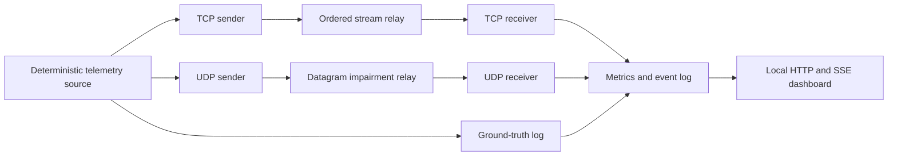

# Project research and decision brief

Date: 2026-11-16 (Asia/Seoul). Status: FreshLink approved; see PROJECT.md for the authoritative scope. Solo work confirmed by the owner. No application code or experimental results exist yet.

## Recommendation

Choose **FreshLink: a live telemetry freshness lab**, an evolution of Lossy-Link Lab. Build a small rover telemetry demonstration that exposes the difference between receiving data and knowing the current state of the world. Make it useful as a teaching and debugging tool for people building live dashboards.

The research question is: **Under which offered loads, queue policies, and impairment conditions does delivering every update make a live display less current?** An equally important question is when dropping updates makes the display worse. We should seek the boundary, not arrange for UDP to win.

The distinctive contribution would be a well-explained experiment, a ground-truth overlay, and a replayable causal trace. Neither reliable UDP nor freshness-aware networking is a new invention. Originality here means an independently built, carefully evaluated educational product. This review cannot establish worldwide novelty or predict the professor's reaction.

## Verified assignment and constraints

The course email dated November 16, 2026, 16:16 KST is titled "Assignment No. 4: Build Something Amazing with Agentic AI." The two-page local PDF is an export of that message; both pages were visually inspected and agree with the email.

- Required: TCP and/or UDP in the backend; a real application demonstration; agentic AI used during development.
- Suggested examples: a network monitoring dashboard and a real-time visualization tool.
- Stated ambitions: solve a real problem, demonstrate technical skill and protocol understanding, and create something demonstrable and publishable.
- Deadline wording: 14 days. November 30, 2026 is an inferred planning date, not a verified LMS submission timestamp.
- The email does not require an LLM inside the finished application. A documented agent-assisted development process fits its wording.
- The owner confirmed this is a solo project. Available working hours and prior socket-programming experience are not yet known.

Repository constraints: Python standard-library transport and HTTP/SSE dashboard, vanilla JavaScript, Windows and Linux compatibility, offline demonstration, loopback by default, seeded impairment, bounded resources, standard-library tests, real measured results, and teach-mode documentation. No package installation is needed for the proposed MVP.

## Three candidates

Effort is a planning judgment, not a measured estimate: M is a focused two-week solo scope; L has substantial risk of exceeding that window. All estimates assume regular daily work and a deliberately simple UI.

| Candidate | Real problem and users | TCP/UDP behavior exposed | One-sentence MVP | Main risk | Effort | Demo moment |
| --- | --- | --- | --- | --- | --- | --- |
| **FreshLink** | Students and telemetry developers can mistake a connected, busy dashboard for a current one. | TCP framing, ordered stream delivery, backpressure; UDP loss/reordering and newest-state filtering; application queue policy. | Send one simulated rover's timestamped state over real TCP and UDP, apply explicitly labeled impairments, and show receiver state against ground truth with freshness metrics. | Confusing application relay stalls with actual TCP packet-loss recovery, or biasing the comparison. | **M** | Increase offered load beyond the emulated service rate: the display can keep updating while falling behind the rover; reduce load or coalesce unsent state and inspect whether freshness improves. |
| **Packet Rescue** | Students struggle to see why reliable delivery needs ACKs, retransmissions, windows, and duplicate protection. | A custom reliable protocol over UDP; selective retransmission; ordered delivery; ACK loss and sequence wraparound; real TCP as a separately labeled baseline. | Deliver a small image or mission manifest through seeded datagram faults while displaying sender window, ACKs, receiver buffer, and verified reconstruction. | Reliability/state-machine bugs consume the time needed for a polished demonstration. | **L** | Drop an ACK: the sender repeats data, but the receiver does not apply it twice; a missing piece eventually completes the picture. |
| **SketchLink** | Students collaborating on unstable connections need durable drawing changes and responsive temporary pointers. | Framed TCP for committed strokes; UDP for ephemeral cursor state; application acknowledgments, reconnect, and idempotency. | Connect two local browser views through Python backend peers, preserving committed strokes while temporary pointer updates tolerate datagram loss. | Reconnection and state convergence expand into a distributed-editing project; browser traffic is not itself raw UDP. | **M-L** | Lose pointer updates, interrupt a connection, and recover the same committed drawing without replaying an old cursor trail. |

**Decision rule:** choose FreshLink for the strongest balance of rigorous networking, visual explanation, and finishability. Choose Packet Rescue if implementing reliability is the main personal learning goal and the UI can stay minimal. Choose SketchLink if having a directly useful collaboration tool matters more than a controlled transport experiment.

## What the literature and existing systems change

### Reliable UDP is valuable but established

The supplied George Washington University assignment already asks for reliable delivery under loss, corruption, duplication, reordering, and delay using a sliding window and ACKs [S1]. Stanford's networking course also teaches transport construction in stages [S2]. This is evidence of educational depth, not evidence of novelty.

Call our implementation an **educational reliable transport over UDP**, not a full TCP implementation. Reproducing some TCP mechanisms does not reproduce its complete connection semantics, congestion behavior, security considerations, or interoperability. A fixed outstanding-packet window is not automatically congestion control.

The game-style split is credible: Photon documents using unreliable movement updates with reliable chat, and Valve documents separate delivery semantics for reliable and unreliable messages [S3, S4]. This validates the design principle but weakens any claim that the channel split itself is original.

### Freshness is a serious research question

Age of Information (AoI) evaluates how old the freshest received status is, rather than merely how quickly delivered packets traveled [S5]. For the proposed lab:

`AoI(t) = current time - generation time of freshest accepted state`

AoI continues increasing while nothing arrives. Delivered-packet latency alone can miss this outage. A queue of obsolete updates creates a useful experiment: compare sending every sample with replacing an unsent state by a newer one. This is an application of existing research, not a new metric.

Use the rover's true trajectory to measure position error as well. AoI is not a complete measure of application value: old information about a stationary rover can still be accurate. Include both stationary and changing-motion workloads.

Mosh provides a practical precedent for synchronizing current state over UDP under intermittent connectivity [S6]. Our product would be a small educational telemetry instrument, not a replacement for Mosh.

### Modern transport is richer than a TCP-versus-UDP slogan

TCP provides a reliable, ordered byte stream; UDP does not supply delivery or duplicate protection [S7, S8]. Neither promises a universal latency advantage.

QUIC provides reliable streams over UDP, and its datagram extension supports unreliable application messages [S9, S10]. Partial reliability also has established precedent in SCTP [S11]. These are useful viva connections. Implementing QUIC, encryption, a new congestion controller, or a full partial-reliability protocol would overwhelm this MVP.

UDP applications also need responsible congestion behavior; the protocol does not provide it automatically [S12]. Our controlled loopback benchmark should have equal documented offered-load caps and report its limited applicability, not claim a deployable Internet transport.

## The critical experimental trap

An ordinary TCP proxy terminates one TCP connection and creates another:

`sender -- TCP connection A --> relay -- TCP connection B --> receiver`

By the time the relay reads bytes, connection A has delivered them through TCP. If the relay discards those application bytes, TCP A will not retransmit them merely because the relay chose not to forward them. TCP B never received those bytes to send. Removing bytes may also destroy application framing.

Therefore **discarding data inside this relay is not equivalent to dropping TCP segments on the wire**. Likewise, duplicating or reordering application bytes creates application-stream corruption, not a faithful TCP segment impairment. This conclusion follows from TCP's service boundary [S7]; Toxiproxy's documentation describes stream-level latency, bandwidth, and connection faults and provides a useful comparison [S13].

Use three explicitly separated kinds of evidence:

1. **Portable MVP:** real TCP and UDP sockets; common emulated delay/service-rate scenarios; preserve the TCP byte stream. UDP-specific loss, duplication, corruption, and reordering are additional labeled cases. Report application queueing and observed delivery stalls. Do not label them measured TCP retransmission stalls.
2. **Optional reliable-UDP project:** drop real UDP datagrams in the relay and observe the reliability algorithm we own. Its ACKs and retransmissions can be instrumented directly, but it is not native TCP.
3. **Optional later native-TCP experiment:** use a controlled below-TCP impairment environment and a packet trace to validate actual segment loss/retransmission. It requires a separate feasibility and permission check, may need privileged/OS-specific tools, and is not a dependency of the two-week MVP.

The portable MVP must not advertise "TCP versus UDP on the same packet-loss path." It can honestly advertise "TCP and UDP application behavior under documented emulated constraints." A scripted stream delay can illustrate ordered waiting, but cannot prove the OS suffered loss-induced head-of-line blocking.

## FreshLink proposed scope, pending approval

### MVP

- One deterministic two-dimensional rover trajectory, plus a stationary control workload. No physics engine or external map service.
- One source process and independent TCP/UDP receiver paths with real standard-library sockets. Explicit lengths and bounded framing for TCP; versioned datagrams and validation for UDP.
- A seeded loopback impairment relay with an ordered byte-preserving TCP path and separately identified UDP datagram faults. Bound queue sizes and define overflow policies.
- A dashboard with ground truth, received position, state age, delivered-update latency percentiles, UDP gaps/reordering, useful update rate, and stale-time fraction.
- A trace connecting source generation, relay admission/delay/drop, receiver acceptance, and UI publication. Backend results are authoritative; rendering delay is a separate quantity.
- Repeatable baseline, congestion/queueing, UDP-loss, and blackout/recovery cases. Export raw data and a run manifest.
- README, protocol explanation, an honest AI log, tests, and a five-minute demonstration.

This is one telemetry lab, not a rover-control platform. Its real users are learners and developers investigating stale displays. The rover supplies an understandable workload.

### Stretch goals, only after the MVP is tested and after scope approval

1. Compare FIFO against latest-unsent-state coalescing with equal budgets, including a well-tuned TCP baseline. Already-transmitted TCP bytes cannot simply be retracted.
2. Recorded-run replay with a packet/event inspector explaining a selected stale interval.
3. One durable annotation/event channel alongside disposable telemetry, with application acknowledgments and idempotent event IDs. This is the hybrid design extension, not a reason to add a whole second product.

Custom reliable UDP is an alternative project, not a promised stretch feature. Exclude real drones, campus probing, public multiplayer, video streaming, audio codecs, authentication infrastructure, cloud dependencies, and runtime LLM calls from the MVP.

### Proposed architecture

The browser's HTTP/SSE channel is an observer outside the impaired paths. It is not the UDP endpoint. Slow SSE clients need bounded queues and state coalescing so the dashboard does not create the effect it purports to measure. Ground truth must not feed receiver decisions.

## Proposed experiments and success criteria

These are plans and hypotheses, not results or validated settings.

**Research questions**

1. How do delivered-packet latency, continuously sampled AoI, and position error disagree?
2. What happens as the offered update rate crosses the emulated service capacity?
3. How much does a queue policy explain compared with transport choice?
4. How do independent UDP loss, burst loss, and total outages differ?
5. Do conclusions change for a stationary source and a rapidly changing source?

**Design controls**

- Start with an unimpaired baseline and vary one factor at a time before mixed conditions.
- Use equal serialized application messages, source schedules, documented send caps, and comparable service-rate budgets. State whether budgets count application or wire bytes.
- Use at least 20 independent fixed-seed runs per condition as an initial plan, with a documented warm-up, observation duration, and drain/timeout interval. More runs may be needed if variation is high. This is separate from repeating network tests at least 20 times.
- Randomize run order and reuse an external time-indexed impairment schedule where comparison is meaningful. An identical random seed alone does not imply identical impairment when packet timings/counts differ.
- Prefer sequential paired trials to two flows competing unintentionally for CPU or a shared bottleneck; use side-by-side views for presentation and document contention experiments separately.
- Distinguish a sequence gap from final loss: reordering can fill gaps later. Count injected drops separately from inferred receive-side loss and end-of-run unresolved messages.
- Compute per-run summaries before across-run comparisons; do not treat every update as an independent experiment. Report N, seeds, conditions, median, p95, p99, and variance. Tail estimates need enough observations and their uncertainty must be acknowledged.
- Sample AoI on a regular time grid, not only at arrivals. Define jitter explicitly, such as absolute changes in successive delivered-update delays, and do not imply it is automatically an RTP jitter estimator.
- During a complete blackout, both receivers become stale. A permanently stopped source will not make UDP recover its missing final update without an added mechanism. Include these counterexamples.

**Metrics**

| Metric | Definition / interpretation |
| --- | --- |
| Update latency, ms | Receive time minus source generation time for a delivered update; report censoring and missing updates separately. |
| Information age, ms | Current time minus generation time of freshest accepted update; unknown before the first update. |
| Stale-time fraction | Fraction of observation time with age above a stated threshold; vary the threshold rather than claiming a universal one. |
| Position error | Distance from received state to ground truth at the same observation time; use simulated distance units. |
| Useful update rate | Accepted updates that advance the freshest known state per second. |
| Recovery time | Time from impairment ending to a specified freshness threshold being regained. |
| Queue occupancy | Separate application, relay, and any observable OS buffers; never imply an unobserved queue was measured. |
| RTT | Explicit echo/ACK turnaround; not assumed equal to twice one-way delay. |

Use `time.perf_counter()` for same-host measurements and verify the process clocks used are comparable on supported runtimes. Cross-host one-way timing would require synchronization and an error analysis; it is outside the loopback MVP. Document OS scheduling/timer granularity and distinguish monotonic timestamps from simulation time.

**Acceptance means** correct framing/malformed-input handling, bounded resources and clean shutdown; reproducing and explaining outcomes under stated conditions; and a demo that works offline. It does not mean achieving a predetermined UDP speedup. Native TCP congestion-window and retransmission values should be marked unavailable unless genuinely instrumented.

## Planned four-minute presentation

1. **0:00-0:30:** Show the live rover and its ground-truth outline; explain that the question is how current the remote view is.
2. **0:30-1:10:** Run the healthy baseline and show real TCP/UDP activity and measured state age.
3. **1:10-2:10:** Apply a recorded low service-rate condition; ask the audience to predict what increasing the update rate will do. Reveal the measured queues and age. Treat worsening freshness as a hypothesis until experiments verify it.
4. **2:10-3:00:** Trigger UDP loss/reordering and then a complete blackout. Show what each fault actually changes and why both paths eventually become stale during silence.
5. **3:00-3:40:** Replay one observed interval and explain it from source/relay/receiver events. If approved and implemented, compare queue policies here.
6. **3:40-4:00:** State one measured finding, one limitation, and one AI-generated mistake that tests or review caught.

Avoid claiming a collision proves a real vehicle is unsafe. This is a controlled simulated telemetry workload.

## Two-week execution proposal

| Dates, 2026 | Deliverable and gate |
| --- | --- |
| Nov 16-17 | Owner selects project; record PROJECT.md, wire format, success criteria, scope, and key decisions. |
| Nov 18-20 | Small tested TCP/UDP core and seeded relay; prove measurement validity before decorating the UI. |
| Nov 21-23 | Complete one end-to-end MVP workload, dashboard, bounded queues, and clean shutdown. |
| Nov 24-26 | Repeated experiments and tests; analyze surprising/negative outcomes; only then consider the first stretch goal. |
| Nov 27-28 | Explain-mode walkthroughs, report, demonstration script, and Windows/Linux checks where available. |
| Nov 29 | Rehearse, follow README in a fresh environment, capture a short demonstration, prepare publication. |
| Nov 30 | Contingency/submission target, pending the actual LMS deadline. |

If the transport/relay measurements are not trustworthy by November 20, reduce impairment modes and visual complexity. If the MVP is not complete by November 23, drop all stretch goals. Do not substitute plausible-looking charts for missing measurements.

## Agentic AI and owner understanding

Use AI to draft small modules, propose edge cases, inspect failures, and help interpret measured traces. The owner reviews the protocol state machine and explains why each retry, timeout, buffer, and ACK exists. Log accepted and rejected suggestions, commands actually run, and mistakes caught. Do not claim human review until it happens.

For this milestone, the owner supplied two ideas and confirmed solo work. Project approval is still pending. A runtime chatbot would add little to the transport explanation and would weaken the offline demo; it is unnecessary for the email's development-process requirement.

## Other directions screened out

- A passive traffic dashboard fits the email, but raises capture/privacy/setup issues and can become a wrapper around existing tools.
- A long-running Wi-Fi probe is useful, but network variability makes live causal demonstrations harder and allowed host targets would need to be defined.
- A full multiplayer game makes gameplay, synchronization, prediction, and art compete with protocol correctness.
- A video-call platform adds codecs, browser-media APIs, NAT traversal, and deployment work well beyond this deadline.
- A generic AI network assistant may look polished while demonstrating little actual transport understanding.

These are scope judgments, not claims that those projects are inherently inferior.

## Sources and how they informed the proposal

Primary technical sources were preferred. No existing assignment solution code was copied or inspected.

- **S1:** [GW Advanced Networking: Reliable UDP assignment](https://gwadvnet20.github.io/assignments/reliable-udp) - establishes prior educational art and common reliability requirements; its assignment-specific wire format is not adopted.
- **S2:** [Stanford CS144](https://web.stanford.edu/class/cs144/) - transport construction is a substantial staged learning exercise, supporting a cautious scope estimate.
- **S3:** [Photon: Low Level Transport and MTU](https://doc.photonengine.com/realtime/v5/reference/low-level-transport) - practical reliable/unreliable channel examples.
- **S4:** [Valve: ISteamNetworkingMessages](https://partner.steamgames.com/doc/api/ISteamNetworkingMessages?language=english) - delivery ordering and unreliable-message semantics.
- **S5:** [Yates et al.: Age of Information: An Introduction and Survey](https://arxiv.org/html/2007.08564v1) - freshness metric and queueing research context; our experimental design is a proposal, not a reproduction of its theoretical claims.
- **S6:** [Mosh project](https://mosh.org/) - state synchronization and intermittent-connectivity precedent.
- **S7:** [RFC 9293: TCP](https://www.rfc-editor.org/rfc/rfc9293.html) - ordered byte-stream service and reliability boundary.
- **S8:** [RFC 768: UDP](https://www.rfc-editor.org/rfc/rfc768.html) - basic datagram semantics.
- **S9:** [RFC 9000: QUIC](https://www.rfc-editor.org/rfc/rfc9000.html) - independent streams and qualified avoidance of cross-stream head-of-line blocking.
- **S10:** [RFC 9221: QUIC DATAGRAM](https://www.rfc-editor.org/rfc/rfc9221.html) - unreliable datagrams can coexist with reliable streams and remain congestion controlled.
- **S11:** [RFC 3758: SCTP Partial Reliability](https://www.rfc-editor.org/rfc/rfc3758.html) - partial reliability is established prior art.
- **S12:** [RFC 8085: UDP Usage Guidelines](https://www.rfc-editor.org/rfc/rfc8085.html) - responsible load/congestion behavior and limits of controlled-environment protocols.
- **S13:** [Shopify Toxiproxy](https://github.com/Shopify/toxiproxy) - stream-proxy impairment capabilities and their layer boundary.

The supplied [Pinggy comparison](https://pinggy.io/blog/udp_vs_tcp_complete_guide/) was opened as context; protocol conclusions above rely on the RFCs and primary documentation instead.

## Verification status

Read the complete repository AGENTS.md, inspected the course email through Gmail, visually inspected both assignment-PDF pages, and reviewed the linked sources. PDF text extraction returned empty text, so it was not treated as evidence of absent content; bundled Poppler rendered the pages successfully. No new dependencies were installed.

Application tests, network experiments, Linux execution, and performance benchmarks: **not run**. There is no implementation yet. No performance numbers in this document are measured results. The owner approved FreshLink after this research was completed.
